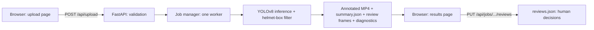

# Real-Time Helmet Violation and Triple-Riding Detection on Two-Wheelers

A YOLOv8 model detects number plates, riders with a helmet, riders without a helmet, and triple riding in traffic
video. A FastAPI backend runs the model, and a two-page browser interface (plain HTML, CSS and JavaScript) handles
upload, progress, playback, download and human review.

> **Every result is a model prediction, not a verified violation.** The model makes mistakes, helmet detection in
> particular. The interface keeps predictions and human-verified decisions visibly separate.

## Detection classes

| ID | Class | Meaning |
|----|-------|---------|
| 0 | `Plate` | A box around a number plate. **Plate text is not read; there is no OCR.** |
| 1 | `WithHelmet` | Rider wearing a helmet |
| 2 | `WithoutHelmet` | Rider without a helmet |
| 3 | `TripleRiding` | Three people on one two-wheeler (a composite class) |

The app refuses to run a model whose stored class names do not match this mapping.

## What is implemented

| Area | Status |
|------|--------|
| Upload with type, size and "does it decode" validation | Implemented, tested |
| Background jobs with real progress, cancel, clear errors | Implemented, tested |
| Annotated video (H.264 for browsers), download, Original/Annotated toggle | Implemented, tested |
| Frame-level counts per class, labelled as such | Implemented, tested |
| Review panel: original and annotated frame, decision, note, saved separately from model output, CSV export | Implemented, tested |
| Helmet-box sanity filter and raw-versus-filtered diagnostics | Implemented, tested (heuristic, unvalidated) |
| Processing statistics (speed, model time per frame, device) | Implemented, tested |
| Dataset audit, leakage check, label contact sheets | Implemented, tested on synthetic data |
| Evaluation report (mAP, confusion matrix, speed) | Implemented; **run it on your data to get results** |
| Tracking (ByteTrack) for approximate distinct IDs | Experimental |
| Plate text recognition (OCR) | Not implemented |
| Associating people with a specific motorcycle | Not implemented |
| Authentication, multi-user use | Not implemented (local use only) |
| Measured accuracy of your `best.pt` | **Unknown until you run `scripts/evaluate.py` on labelled data** |

## Architecture



```
app/
  main.py        FastAPI app: pages, upload, jobs, results, reviews
  detector.py    model loading, class check, inference, filtering, counting, video pipeline, diagnostics
  jobs.py        background job queue (one worker, so the CPU is not oversubscribed)
  reviews.py     human review decisions, stored apart from model output
  cleanup.py     retention helpers (only touch files this app created)
  config.py      paths and limits (environment variables override them)
  templates/     base.html  upload.html (page 1)  results.html (page 2)
  static/        style.css  common.js  upload.js  results.js
scripts/
  audit_model.py        class names; box sizes on real footage; what the helmet filter removes
  inspect_dataset.py    label checks, class balance, and leakage between splits
  visualize_dataset.py  contact sheet of images with their labels drawn on
  doctor.py             checks install, model, classes, one frame of inference, video encoding
  evaluate.py           precision, recall, mAP, confusion matrix, speed -> reports/model_evaluation.md
  download_dataset.py   validate a ZIP / download from Kaggle with your own credentials
  make_sample_clip.py   cut a short 720p clip from a long 4K video
  cleanup.py            remove old uploads and results (dry run by default)
tests/        pytest suite and a browser-simulation test
reports/      generated evaluation output (see reports/README.md)
models/best.pt   your trained weights (not committed)
```

Your own `src/` scripts are untouched and still work.

## Installation (Windows, PowerShell)

```powershell
cd D:\Projects\helmet-violation-detection
python -m venv .venv                 # skip if .venv already exists
.\.venv\Scripts\Activate.ps1         # if blocked: Set-ExecutionPolicy -Scope Process RemoteSigned
python -m pip install --upgrade pip
pip install -r requirements.txt
```

`imageio-ffmpeg` supplies an ffmpeg binary so the annotated video is re-encoded to H.264, which browsers can play.
Without it the video is still produced and downloadable, but most browsers cannot play it inline.
`lapx` is needed only for the optional tracker.

## Quickest start on Windows

Double-click `START_WINDOWS.bat`. It creates the virtual environment on first use, installs the requirements, checks
the bundled `models\best.pt` and your setup, then starts the app at <http://127.0.0.1:8000>. The first run downloads
PyTorch, which takes several minutes. If it stops with an error, read the message above it, or see Troubleshooting below.

## First, check that everything works (doctor)

```powershell
python scripts\doctor.py                                   # install, model file, video writing
python scripts\doctor.py --video videos\sample_clip.mp4    # also runs the model on one real frame
```

It prints PASS, WARN or FAIL for each requirement and, for a FAIL, the exact fix. It changes nothing. It can show that
the model file loads, has the right four classes and runs on a real frame; it cannot show that the model is accurate.

## Run the web app

```powershell
uvicorn app.main:app --host 127.0.0.1 --port 8000
```

Open <http://127.0.0.1:8000>. The header shows whether the model loaded and on which device.

**Page 1, Upload and settings (`/`)**
1. Choose or drop a video and check the preview.
2. Set the confidence threshold and how often the model runs. Advanced options: inference size, output video size,
   the helmet-box filter, filter diagnostics, and the tracker.
3. Click **Start detection**. You move to page 2.

**Page 2, Detection results (`/results/<job id>`)**
1. A progress screen shows the frame count and elapsed time, with a Cancel button.
2. Then: the annotated video (with an Original tab), a download button, summary tiles (including speed), frame-level
   counts, the review panel, and the filter diagnostics if you turned them on.
3. **Change settings and run again** returns to page 1 with the same video loaded.

Page 2 has its own address, so you can refresh or bookmark it. Finished results are reloaded from
`results/<job id>/summary.json`, so they survive a server restart.

Tips for a CPU laptop: cut a short clip first, because a 4K, 60 FPS video takes a while.

```powershell
python scripts\make_sample_clip.py "videos\sample.mp4.mp4" --seconds 8 --width 1280
```

"Run the model on every 3rd/5th frame" speeds things up a lot; skipped frames reuse the previous boxes in the
output and are not counted. The output video is 1280 px wide by default; "Original size" keeps the full 4K frame but
makes very large files and slows processing.

### Settings (environment variables)

| Variable | Default | Purpose |
|----------|---------|---------|
| `HELMET_MODEL_PATH` | `models/best.pt` | weights file |
| `HELMET_DEVICE` | `cpu` | `cpu`, `cuda` (only used if a GPU exists) or `auto` |
| `HELMET_MAX_UPLOAD_MB` | `500` | upload size limit |
| `HELMET_UPLOAD_DIR`, `HELMET_RESULTS_DIR` | `uploads/`, `results/` | storage |
| `HELMET_RETENTION_HOURS` | `0` (never) | on startup, delete uploads and results this app created that are older than this |

Example: `$env:HELMET_DEVICE="auto"; uvicorn app.main:app`.

## What the numbers mean

- Counts are **frame-level detections**: how many boxes the model drew, summed over the frames it processed. One rider
  visible for 100 frames can add up to 100. They are not riders, vehicles or violations.
- "Distinct track IDs" (optional, experimental) come from a ByteTrack tracker. IDs can switch or split, so this is a
  rough estimate and still not a verified count.
- High confidence does not mean correct.
- Processing speed and model time per frame are measured for that run on that machine.

## Human review

The **Frames to review** panel shows the highest-confidence `WithoutHelmet` and `TripleRiding` frames, at least two
seconds apart. For each you can switch between the annotated and the original frame, mark **Confirmed** or **Not a
violation**, and add a note. Decisions are saved on the server in `results/<job id>/reviews.json`, **separately from
`summary.json`**, so a decision never overwrites what the model predicted. Only these decisions count as verified.
**Download review log (CSV)** exports frame, model label and confidence, your decision and note.

## Helmet-box sanity filter and diagnostics

Your model sometimes draws `WithoutHelmet` over whole scooters or several people. **Hide implausible helmet boxes**
(on by default) drops a `WithHelmet`/`WithoutHelmet` box when it covers more than 8% of the frame, is more than 2.5
times longer than wide (or tall), or encloses the centres of two or more smaller helmet boxes. The number hidden is
reported on the results page.

This is a rule of thumb that has **not** been validated against labelled data, and it treats a symptom, not the
cause. It can hide a bad prediction but cannot make the model recognise a helmet correctly.

Tick **Save filter diagnostics** to check it. The results page then shows example frames where removed boxes are drawn
in grey and kept boxes in colour, and lets you download every raw prediction (`diagnostics.jsonl`: raw, kept and
removed boxes for each processed frame). If the grey boxes are real riders, the filter is hiding correct predictions.
Tune the filter only if it measurably improves precision without an unacceptable loss of recall.

## Investigating detection quality

Run these in order. Each reports measurements; none changes your data or your model.

```powershell
# 1. Does the model load, are the class names right, how big are its helmet boxes on real footage,
#    and what does the filter remove? (saves example frames to results\audit_diagnostics)
python scripts\audit_model.py --model models\best.pt --video videos\sample_clip.mp4 --frames 40

# 2. If you have the dataset: are the labels sane? Class IDs, coordinates, box sizes, class balance,
#    images without labels, and the same or near-identical images in different splits (leakage).
python scripts\inspect_dataset.py --root data\raw

# 3. Look at the labels yourself: images that contain a LARGE WithoutHelmet box
python scripts\visualize_dataset.py --root data\raw --class WithoutHelmet --min-area 0.08 --n 24

# 4. Real accuracy on held-out labelled data -> reports\model_evaluation.md
python scripts\evaluate.py --data data\raw\data.yaml --split test
```

Possible causes to check, not conclusions: region-sized helmet labels in the training data; swapped or inconsistent
class IDs between `data.yaml` and the label files; few or varied `WithHelmet` examples (its mAP@50 of about 0.46 was
your earlier validation result); the same images in train and test (leakage); training images that differ from
elevated 4K traffic cameras; training at 640 px while distant heads are only a few pixels wide. A large box is not
automatically a wrong label: decide whether it matches what the class is meant to cover before changing anything.
Retrain only if steps 2 to 4 show a problem in the data, and keep the current `best.pt` until a candidate beats it on
the same held-out test split.

`evaluate.py` runs validation twice: at confidence 0.001 for mAP, and at 0.25 (the app's default, change it with
`--cm-conf`) for the confusion matrix and the per-class true positives, false positives and false negatives. It
omits those counts rather than show wrong ones if the matrix fails a consistency check. If the dataset has no `test`
split, `--split val` works but those scores are optimistic, and the report says so.

### Getting the dataset (only if you need it)

The Kaggle dataset is `devgurucodes/trafffic-violations-triple-riding-no-helmet-plate` (the triple "f" is on Kaggle).

First find out why your `archive.zip` failed. This changes nothing on disk:

```powershell
python scripts\download_dataset.py --validate-only archive.zip
```

To download it yourself you need a Kaggle account and an API token:

1. Kaggle, Settings, API, **Create New Token** downloads `kaggle.json`.
2. Save it as `%USERPROFILE%\.kaggle\kaggle.json`. Never commit or share it. (Or set `KAGGLE_USERNAME` and `KAGGLE_KEY`.)
3. `pip install kaggle`, then `python scripts\download_dataset.py --dest data`.

The script validates the ZIP before extracting, blocks unsafe paths, and does not re-extract or delete anything.
`data.yaml` may still contain Colab paths; edit its `path:` line to the folder on your PC.

## API

| Method and path | Purpose |
|-----------------|---------|
| `GET /api/health` | model status, device, class mapping, limits, whether an H.264 encoder exists |
| `POST /api/upload` | multipart `file`; validates type, size and that it decodes; returns `video_id` and metadata |
| `GET /api/uploads/{video_id}` | metadata of an uploaded video (404 if it is gone) |
| `GET /api/uploads/{video_id}/video` | the uploaded video (preview) |
| `POST /api/jobs` | JSON `{video_id, confidence, imgsz, frame_stride, track, sanity_filter, diagnostics, output_width, filename?}`; returns `202` and a job |
| `GET /api/jobs/{job_id}` | status (`queued`, `processing`, `completed`, `failed`, `cancelled`), progress, result |
| `POST /api/jobs/{job_id}/cancel` | stop a running job |
| `GET /api/results/{job_id}/video` | annotated video; add `?download=1` to download |
| `GET /api/results/{job_id}/flagged/{name}` | a review frame (`flagged_NN.jpg` annotated, `flagged_NN_raw.jpg` original) |
| `GET /api/results/{job_id}/diagnostics/{name}` | diagnostic frame or `diagnostics.jsonl` (when diagnostics were saved) |
| `GET /api/jobs/{job_id}/reviews` | saved review decisions |
| `PUT /api/jobs/{job_id}/reviews/{name}` | save a decision: `{decision: confirmed\|rejected\|unreviewed, note}` |
| `GET /api/jobs/{job_id}/reviews.csv` | review log as CSV |

Pages: `GET /` (upload) and `GET /results/{job_id}` (progress and results). Interactive docs: <http://127.0.0.1:8000/docs>.

```powershell
curl.exe -F "file=@videos\sample_clip.mp4" http://127.0.0.1:8000/api/upload
curl.exe -X POST http://127.0.0.1:8000/api/jobs -H "Content-Type: application/json" -d "{\"video_id\":\"<id>\",\"confidence\":0.3}"
curl.exe http://127.0.0.1:8000/api/jobs/<job_id>
```

Results are stored in `results/<job_id>/` (`annotated.mp4`, `summary.json`, review frames, `reviews.json`, and
`diagnostics/` if enabled). Your own files in `results/` are never touched. Failed or cancelled jobs leave no output
behind.

## Storage and cleanup

Nothing is deleted automatically unless you set `HELMET_RETENTION_HOURS`. To clean up by hand:

```powershell
python scripts\cleanup.py --older-than-hours 72            # dry run: lists what would go
python scripts\cleanup.py --older-than-hours 72 --delete   # removes it
```

Only items with a server-generated name (`uploads/<id>.mp4`, `results/<id>/`) are ever touched. Your own files, such
as `results\test_detection.mp4` or `videos\`, are never listed or removed. Interrupted uploads (`*.part`) are removed
on startup. The server binds to `127.0.0.1` by default; there is no login, so do not expose it publicly without adding
authentication.

## Tests

```powershell
pip install -r requirements-dev.txt
pytest -q
```

Most tests use a scripted fake engine, so they check the pipeline, API, validation, counting, reviews and cleanup, not
model accuracy. Tests in `tests/test_real_model.py` use real weights and are skipped when `models/best.pt` (or the stock
`models/yolov8n.pt` for API plumbing tests) is absent. Run them on your machine to verify your actual model.

Frontend-to-backend check (runs the real pages and scripts in jsdom against a running server, covering upload, start,
hand-over to the results page, results, tabs, saved reviews, reload, diagnostics and the not-found case; needs Node.js):

```powershell
npm install --no-save jsdom
uvicorn app.main:app --port 8000          # in a second terminal
node tests\frontend_e2e.mjs http://127.0.0.1:8000 videos\sample_clip.mp4
```

A second check, `tests\frontend_recheck_e2e.mjs`, starts from a server with no model and confirms the badge turns green after you copy `best.pt` in and return to the tab.

jsdom does not play video or lay out the page. Open the pages in Chrome or Edge to check appearance and playback, and
play the downloaded video in VLC and Windows Media Player.

## Troubleshooting

| Symptom | Cause | Fix |
|---------|-------|-----|
| Red badge "Model file not found: ...best.pt" | `best.pt` is not at that exact path | Copy your trained `best.pt` there (the badge shows the full path), or set `HELMET_MODEL_PATH`. The page re-checks when you click the badge or return to the tab, so no restart is needed |
| Badge "class mapping does not match" | A different model, for example `yolov8n.pt` | Use the `best.pt` from your 4-class training run |
| Badge mentions `c10.dll`, `WinError 126` or "cannot start" | PyTorch is broken on this PC | Reinstall PyTorch for your Python version, then `pip install -r requirements.txt` |
| Badge mentions "failed a test inference" or `torchvision::nms` | PyTorch and torchvision versions do not match | Reinstall both from the same release |
| Detection finishes but every count is 0 | Not an error. The results page lists what to check | Lower the confidence to 0.10, switch the helmet filter off to compare, and run `scripts\audit_model.py` |
| Result video downloads but will not play in the browser | No H.264 encoder | `pip install imageio-ffmpeg`, restart, process again; or play the download in VLC |
| Terminal shows `ConnectionResetError ... _call_connection_lost` | The browser closed a video connection | Harmless; hidden by default |

`python scripts\doctor.py` finds most of these in one go. `GET /api/health` reports the model path, whether the file
exists, its size, the device and whether an H.264 encoder is available.

## Limitations

- **Accuracy of your model is unproven.** Earlier validation mAP@50 figures (Plate about 0.82, WithoutHelmet about
  0.76, TripleRiding about 0.88, WithHelmet about 0.46) came from your training run. They are not evidence of
  real-world accuracy, and nothing here re-measures them until you run `scripts/evaluate.py` on labelled data.
- Counting is per frame. Without verified tracking there is no reliable number of unique violators.
- `TripleRiding` is a learned composite class. It does not count people or tie them to one motorcycle.
- Plates are detected, not read.
- The app is single-user and local: no authentication; in-memory job state (finished results reload from disk).
- Large videos on CPU are slow. By default output is downscaled to 1280 px wide and inference runs on that frame.
- Only the first video stream is processed; audio is dropped.

## Future improvements

Fix or relabel region-sized helmet labels and retrain with more `WithHelmet` examples; add rider-to-vehicle
association (assign helmet boxes to the motorcycle they belong to) if evaluation justifies it; add plate OCR as a
separate, evaluated feature; generate false-positive and false-negative galleries from a labelled set; add
authentication before any shared deployment.

## Publishing to GitHub

```powershell
git init
git add .
git status            # check: no .venv, videos, uploads, results, data, *.zip, kaggle.json
git commit -m "Helmet violation and triple-riding detection"
git branch -M main
git remote add origin https://github.com/<you>/<repo>.git
git push -u origin main
```

`.gitignore` already excludes weights, videos, results, datasets, generated report images and credentials. `best.pt`
is small enough for a GitHub Release or Git LFS if you want to share it. If a secret was ever committed, revoke it on
Kaggle and rewrite history; deleting the file in a later commit is not enough.

## Credits

Dataset: Kaggle, `devgurucodes/trafffic-violations-triple-riding-no-helmet-plate` (check its licence before
redistributing any part of it). Model: Ultralytics YOLOv8.
